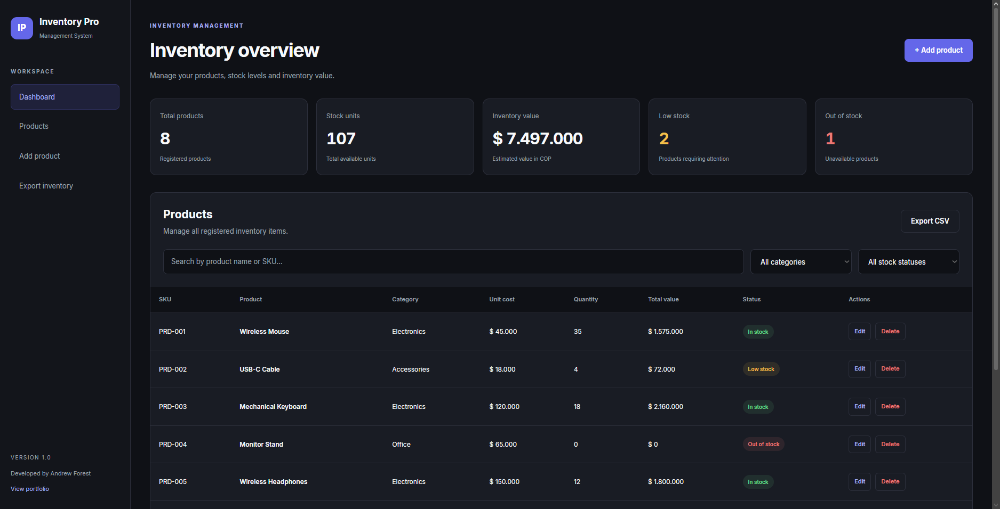

# Inventory Pro — Inventory Management System

## Live Demo

https://andrewforest-dev.github.io/inventory-management-system/

## Application Preview

## Project Overview

Inventory Pro is a web-based inventory management
application designed to help small businesses manage
products, stock levels and inventory information.

The project combines software development fundamentals,
business logic, data persistence, automated testing
and professional UX/UI design.

## Business Problem

Small businesses often manage inventory manually
using spreadsheets or physical records.

This can lead to inconsistent information,
stock shortages and difficulties tracking products.

Inventory Pro provides a structured interface
for local inventory management.

## Features

- Complete CRUD operations.
- Product registration, editing and deletion.
- Product search by name or SKU.
- Category and stock status filtering.
- Dynamic dashboard statistics.
- Inventory value calculation in COP.
- Low-stock and out-of-stock indicators.
- LocalStorage data persistence.
- Product data validation.
- Duplicate SKU prevention.
- CSV inventory export.
- CSV formula injection mitigation.
- Responsive interface design.
- Error handling and notifications.
- Automated unit testing.
- Continuous integration with GitHub Actions.
- Public deployment with GitHub Pages.

## CRUD Operations

| Operation | Implementation |
|---|---|
| Create | Register new products |
| Read | Display, search and filter products |
| Update | Modify existing product information |
| Delete | Remove products with confirmation |

## Software Architecture

The application separates responsibilities
into independent modules.

### Presentation Layer

HTML5 and CSS3 provide the dashboard interface,
forms, tables, notifications and responsive layout.

### Application Controller

The app.js module connects the user interface
with business logic and data persistence.

### Business Logic Layer

The inventory.js module handles CRUD operations,
validation, search, filtering and calculations.

### Data Persistence Layer

The storage.js module manages LocalStorage,
JSON serialization and data integrity.

## Technologies

- HTML5
- CSS3
- Vanilla JavaScript
- JavaScript DOM API
- LocalStorage API
- JSON
- Node.js
- Git and GitHub
- GitHub Actions
- GitHub Pages

## Product Data Model

| Field | Type |
|---|---|
| ID | UUID |
| SKU | String |
| Name | String |
| Category | String |
| Price | Number |
| Quantity | Integer |
| Created at | ISO Date |
| Updated at | ISO Date |

## Business Rules

- Product SKUs must be unique.
- Required fields cannot be empty.
- Product prices cannot be negative.
- Stock quantities must be non-negative integers.
- Zero units means out of stock.
- One to four units means low stock.
- Five or more units means in stock.
- Inventory value is calculated using unit cost
  multiplied by quantity.

## Project Structure

    inventory-management-system/
    ├── .github/
    │   └── workflows/
    │       └── javascript-validation.yml
    ├── css/
    │   └── style.css
    ├── js/
    │   ├── inventory.js
    │   ├── storage.js
    │   └── app.js
    ├── tests/
    │   ├── inventory.test.js
    │   └── storage.test.js
    ├── index.html
    └── README.md

## Local Installation

1. Clone or download the repository.
2. Open the project directory.
3. Serve the project using a local web server.
4. Open the application in a modern browser.

No external frontend dependencies are required.

## Automated Testing

The project uses the native Node.js test runner.

Run all tests with:

    node --test tests/inventory.test.js tests/storage.test.js

### Test Results

| Test Category | Passed |
|---|---:|
| CRUD Operations | 9 |
| Product Validation | 9 |
| Stock Business Rules | 3 |
| Inventory Calculations | 3 |
| Search and Filtering | 6 |
| CSV Export | 3 |
| Storage and Data Integrity | 21 |
| Total | 54 |

### Validation Environments

| Environment | Result |
|---|---|
| Node.js 22 | Passed |
| Node.js 24 | Passed |

All 54 automated test cases completed successfully.

Storage tests use a mock storage implementation
to simulate persistence and error scenarios.

## Continuous Integration

GitHub Actions automatically validates JavaScript
syntax and executes automated tests on Node.js
22 and 24.

The workflow runs when changes are pushed to
the main branch or submitted through pull requests.

## Manual Functional Testing

The following features were verified manually:

- Product creation.
- Product display.
- Product editing.
- Product deletion.
- Product name search.
- Category filtering.
- Stock status filtering.
- Duplicate SKU prevention.
- Dashboard calculations.
- CSV export.

Mobile testing and browser persistence verification
remain pending.

## Development Status

The initial frontend version has been implemented
and deployed through GitHub Pages.

The application includes eight demonstration products.

This version stores information locally in the
browser. It does not include a centralized database,
authentication or multi-user synchronization.

## Future Improvements

- REST API integration.
- Node.js and Express backend.
- MySQL database.
- User authentication.
- Role-based access control.
- Inventory movement history.
- Advanced reporting.
- End-to-end browser testing.

## Learning Objectives

- Software development fundamentals.
- CRUD operations.
- Modular software architecture.
- Business logic implementation.
- Data validation and persistence.
- Error handling.
- Automated unit testing.
- Continuous integration.
- Technical documentation.
- Responsive UX/UI design.
- Web application deployment.

## Author

Andrés Devia | Andrew Forest

Web Developer | Software Development Student | UX/UI Designer

- Portfolio: https://andrewforest.com
- GitHub: https://github.com/andrewforest-dev
- Agency: https://nexxoagencia.com

